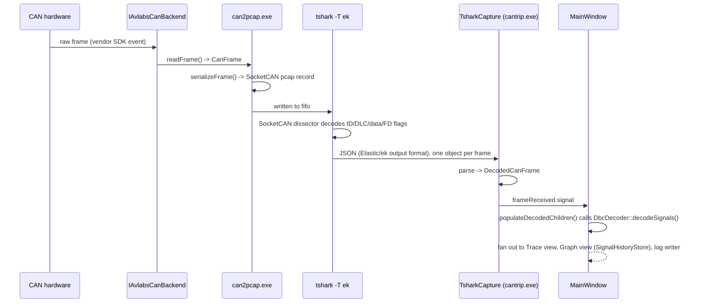

# Data Flow

!!! note "The capture loop moved into cantrip.exe"
    This page still describes `can2pcap.exe` as a separate process. The same
    capture code now runs as a thread inside `cantrip.exe` and feeds `tshark`
    over a named pipe (`common/PcapCapture.h`), so nothing has to be installed
    into Wireshark. `can2pcap.exe` remains as an optional Wireshark extcap
    built from that same code. Everything below about what the capture loop
    does still holds, only where it runs has changed.

How one CAN frame actually gets from a bit on the wire to a decoded signal
on screen (or a logged line, or a plotted point):

## Where each responsibility actually lives

- **Backend → `can2pcap.exe`**: `readFrame()` is documented and used as
  non-blocking - it returns immediately whether or not a frame arrived,
  and `can2pcap.exe`'s capture loop sleeps briefly when idle rather than
  blocking. See [The AVlabs CAN Backend](can-backend-abstraction.md).
- **`can2pcap.exe`**: the *only* place that knows about the SocketCAN wire
  format. This is also where the CAN FD DLC-code-to-byte-length
  translation happens - see the note on `CanFrame::dlc` in
  [The AVlabs CAN Backend](can-backend-abstraction.md#the-dlc-code-vs-byte-length-trap).
- **`tshark`**: does the actual low-level frame dissection (ID/DLC/data/FD
  flags), using Wireshark's own built-in SocketCAN dissector. CANtrip
  never re-implements this.
- **`TsharkCapture`** (`app/TsharkCapture.cpp`): parses `tshark`'s JSON
  output into a `DecodedCanFrame` - CANtrip's own in-process frame
  representation, distinct from the wire-level `CanFrame` struct backends
  use.
- **`DbcDecoder`** (`app/DbcDecoder.h/.cpp`): DBC load + signal decode -
  a plain, non-GUI class (extracted out of `MainWindow` specifically so
  [headless mode](../headless-mode.md) could reuse it
  without a `MainWindow` to host it).
- **`MainWindow`**: `onFrameReceived()` fans each frame out to everything
  that cares about it: the log file, `SignalHistoryStore` for the Graph
  view, and the Trace view. Logging and the Graph view get every frame
  there, before any display throttling.
- **`TraceModel`** (`app/TraceModel.h/.cpp`): the Trace view's data, raw
  frames in a buffer capped at 100,000 rows. Text is only formatted for
  rows on screen, and signals are only decoded when a row is expanded, so
  its cost doesn't grow with the length of a capture. It applies the
  column filters and the sort itself, because a `QSortFilterProxyModel`
  on top missed a 30 Hz refresh at the row cap.
- **`SignalHistoryStore`** (`app/SignalHistory.h/.cpp`): every sample of
  every decoded signal, for the whole capture. Each signal is a
  `SignalSeries`: the raw samples in fixed-size chunks, plus a small
  pyramid of min/max buckets (8 samples per bucket, then 64, then 512...).
  `SignalSeries::decimate()` uses the pyramid to turn any time range into
  at most two points per pixel column.
- **`GraphView`**: never appends to its chart per sample. A 30 Hz timer
  checks whether the store or the view (time range, plot width) changed,
  and if so replaces each plotted line's points with a fresh `decimate()`
  result. Hidden windows skip the work entirely. Cursor readouts read the
  store directly, so they always land on a real sample.

## The transmit side feeds the same pipeline

[`MessageSender`](send-message-internals.md)'s `frameSent` signal connects
straight to the same `onFrameReceived` slot a live capture's
`frameReceived` signal does - a frame CANtrip itself transmits gets
logging, Trace/Graph display, and DBC decode entirely for free, with no
separate code path. It's marked as `Tx`-direction so it can be visually
distinguished (see [Stimulation Tab](../user-guide/stimulation-tab.md#received-pane)),
but it flows through exactly the same machinery.

## Replay feeds it too

[`LogReplaySource`](logging-and-replay.md) also connects to the same
`onFrameReceived` slot as `TsharkCapture` and `MessageSender` - see
[Logging & Replay](logging-and-replay.md).
