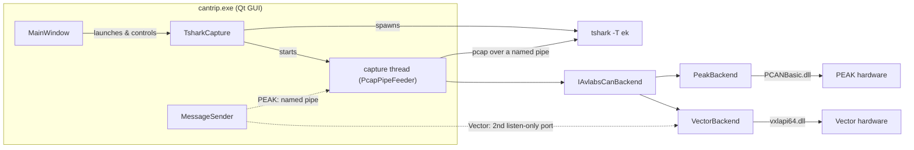

# Process Architecture

  <iframe src="../../media/architecture.html#embed" title="How CANtrip is built" loading="lazy" allow="fullscreen" allowfullscreen></iframe>

A three-minute walkthrough of everything in this section: the three processes, the vendor-neutral backend,
the pcap wire format, the frame pipeline, transmit internals and the bugs that shaped them.
<a href="../../media/architecture.html">Open it full page</a> for chapters and a transcript.

CANtrip does not reimplement CAN capture or low-level frame dissection.
Instead it hands that to Wireshark: a capture thread inside `cantrip.exe`
reads the hardware through a vendor-neutral abstraction and serves the
frames as pcap on a named pipe, and `tshark` reads that pipe and dissects
them. Nothing is installed into Wireshark for this. (`can2pcap.exe` is the
same capture code packaged as an optional Wireshark
[extcap](https://www.wireshark.org/docs/wsdg_html_chunked/ChCaptureExtcap.html),
for capturing from Wireshark's own window. CANtrip itself doesn't use it.)

## Why route through Wireshark at all

The capture thread translates whatever it reads from a CAN backend into
SocketCAN-format pcap records, and writes them to the named pipe `tshark`
reads from. Wireshark's own built-in SocketCAN dissector already knows how to
decode CAN ID / DLC / data / FD flags from that format for free - CANtrip
gets a correct, well-tested low-level decoder without writing or
maintaining one itself. CANtrip's own DBC layer adds signal-level decode
strictly on top of that, in `MainWindow`, not in the capture thread.

The capture thread has no dependency on the GUI, which is also what makes it
possible to drive the whole capture pipeline from the command line with no
window at all - see [Headless Mode](../headless-mode.md).

## The two Send Message paths

The dotted lines above are [Send Message's](../user-guide/stimulation-tab.md)
transmit path, and they're genuinely different per vendor, not a stylistic
choice:

- **Vector**: `MessageSender` opens a second port directly on the same
  channel with a zero permission mask (listen-only), and writes frames on
  that port itself. `cantrip.exe` never needs the capture thread's cooperation
  to transmit.
- **PEAK**: PCAN-Basic has no equivalent to that permission-mask concept -
  there's no way to open a second handle onto a channel the capture thread
  already initialized. So `MessageSender` instead connects to a named pipe
  the capture thread itself creates, and the capture thread writes the frame out on
  the one handle it already owns.

The full mechanism, including exactly why the naive "just open a second
PEAK handle" approach fails, is in
[Send Message Internals](send-message-internals.md).

## Multi-vendor hardware support

There's no OS-level CAN abstraction on Windows (unlike Linux's SocketCAN) -
every vendor ships its own proprietary DLL and API shape. CANtrip works
around this with a vendor-neutral interface, **the AVlabs CAN backend**
(`common/AVlabsCanBackend.h`); one bus to sniff them all. The
capture thread and the rest of `cantrip.exe` only ever talk to that interface,
never to a vendor SDK directly. See
[The AVlabs CAN Backend](can-backend-abstraction.md) for the interface
itself, and [`CONTRIBUTING.md`](https://github.com/avmolaei/CANtrip/blob/main/CONTRIBUTING.md#adding-a-new-vendor-backend)
for how to add support for a new vendor.
