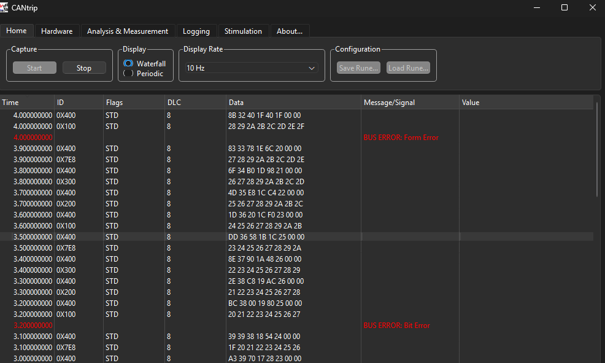
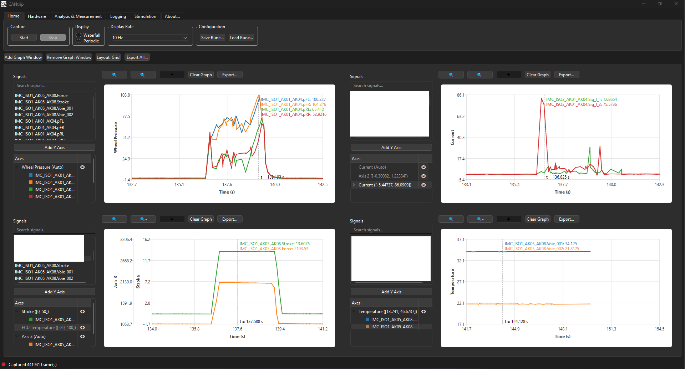

# Analysis & Measurement Tab

## Import DBC

**Import DBC...** loads a `.dbc` file and decodes every subsequent frame
whose CAN ID matches a message defined in it, via
[dbcppp](https://github.com/xR3b0rn/dbcppp). Decoded signals appear as
child rows under their frame in the Trace view (expand the arrow next to a
row), and become available to plot in the [Graph view](#graph-view).

The repository ships [`test/sample.dbc`](https://github.com/avmolaei/CANtrip/blob/main/test/sample.dbc)
for trying this against the synthetic test source with zero hardware - see
[Getting Started](getting-started.md#try-it-with-no-hardware-at-all).

The loaded DBC's path is saved in [Runes](runes.md), and re-imported
automatically when that rune is loaded.

## Trace vs Graph view

This tab switches the whole content area between two views:

- **Trace** - the frame table (also what's showing by default on every
  other tab). Click the arrow next to a row to unfold it into decoded
  signals, name/physical-value/unit, straight from the imported DBC.

  

  Column order and widths are drag-to-rearrange/resize, and persist
  through [Runes](runes.md).

- **Graph** - see below.

## Graph view

A signal-plotting view, all sharing one time X axis:

- **Signal list** (left side) - every signal from every imported DBC
  message, searchable. Drag one onto an axis to plot it, or multi-select
  and drag several at once onto the same axis.
- **Y axes** - add as many as you want, each can host multiple signals.
  Auto-scale or set fixed bounds per axis; each plotted signal gets its own
  color and line style (solid/dashed/dotted/scatter). An eye-toggle per
  axis hides/shows it without removing its configuration.
- **Zoom** - rectangle-select an area to zoom into it, scroll-wheel zoom
  per-axis, and a reset button to snap back out.
- **Cursors** - hover for a live readout of every plotted signal's value
  at that point in time; click-drag between two points for a delta
  measurement (time and value difference).
- **Clear Graph** - resets plotted data back to t=0 without discarding your
  axis/signal layout, so Start → Stop → Start doesn't make you rebuild the
  whole view from scratch.

### The whole capture stays plottable

The Graph view keeps every sample of every decoded signal for the whole
capture, not just the last few seconds. Reset the zoom after an hour and
you see the whole hour. Plot a signal you hadn't plotted before and its
line starts at t=0, not at the moment you dropped it.

A long capture stays quick to draw because the plot never draws more than
two points per pixel: zoomed out, each pixel column shows that stretch's
lowest and highest value, so a one-sample spike is still visible. Zoom in
far enough and you are looking at the raw samples again. Cursor readouts
and delta measurements always use the real samples, at any zoom.

This history lives in memory, about 18 bytes per sample. As a guide, a bus
that decodes 10,000 signal values per second uses about 650 MB per hour.
Past 2 GB, CANtrip starts thinning the oldest data: every 4 old samples
become their lowest and highest, so the start of the capture loses detail
but stays on the graph. The status bar says so when that happens.
[Logging](logging-tab.md) is not affected and always keeps every frame.

### Multiple windows

Up to 6 independent graph windows at once, arranged **Stacked** (each full
width, scrollable) or **Grid**. Each window's full axis/signal layout is
saved in [Runes](runes.md).

### Export

Export the current window as PNG, SVG, or PDF, or **Export All** to export
every open graph window in one pass.
