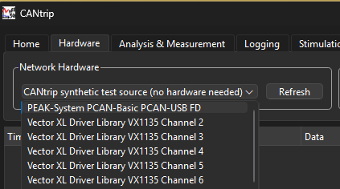
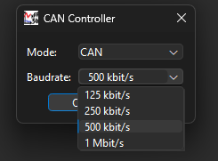
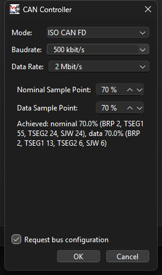
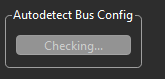
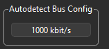
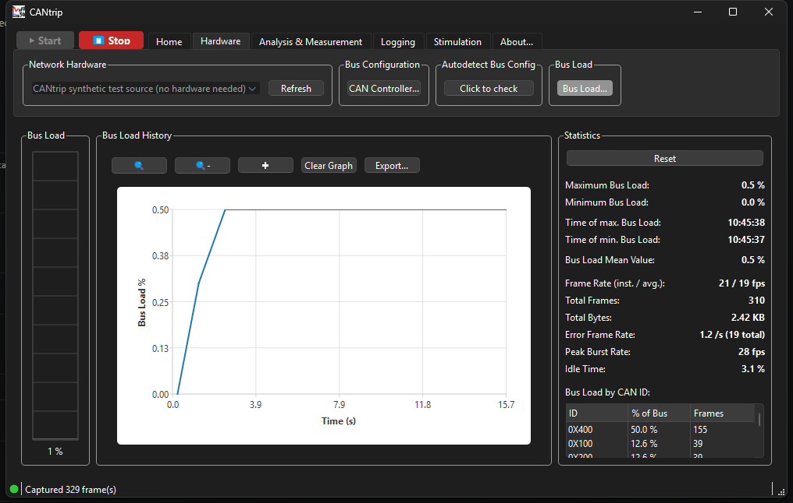

# Hardware Tab

## Network Hardware

The dropdown lists every CAN channel CANtrip could find, across every
vendor SDK actually installed on the machine, plus the always-available
synthetic test source (see [Getting Started](getting-started.md#try-it-with-no-hardware-at-all)).
**Refresh** re-scans if you plugged in hardware after launching CANtrip.

CANtrip isn't tied to one CAN adapter vendor - see
[Architecture: The AVlabs CAN Backend](../architecture/can-backend-abstraction.md)
for how that actually works.

### More buses

**More buses...** lists the buses of the session. CAN 1 is always on and is
the same channel as the dropdown. Tick CAN 2, CAN 3 or CAN 4 and pick a
channel for each to capture them at the same time, in the same window. The
**+** at the bottom adds further buses, up to 16 in all. Every bus needs
its own channel.

Bitrates and CAN FD are not set here. Each bus gets its own tab in the
[CAN Controller](#can-controller) dialog.

With more than one bus:

- **Start** starts all of them, and **Stop** stops all of them. If a bus's
  channel isn't available, nothing starts and a message says which bus is
  the problem.
- The Trace view gains a **Bus** column, which you can filter and sort like
  any other. The same ID on two buses is two separate rows in Periodic
  mode.
- Signals from the other buses are offered to the Graph view with the bus
  in front, for example `CAN2.EngineData.EngineSpeed`.
- Logs hold all buses in one file. The bus number is the channel column of
  an ASC or CSV log, and a replayed log brings its buses back.
- All buses share one timeline that starts at the first frame seen on any
  of them. Spacing between frames of the same bus is exactly what the
  adapter reported. Alignment between buses comes from when each bus's
  first frame arrived, so allow a few milliseconds when comparing times
  across buses.
- The bus list and each bus's configuration are saved in [runes](runes.md).

[Autodetect](#autodetect-bus-config), [Bus Load](#bus-load-statistics),
the [Gateway](#gateway) and transmitting from the
[Stimulation tab](stimulation-tab.md) all work per bus.

## CAN Controller

With more than one bus ticked in [More buses](#more-buses), this dialog has
one tab per bus. Each tab holds everything described below for that bus
alone, so one bus can be classic CAN while another runs CAN FD.

Click **CAN Controller...** to configure bus timing. Three modes:

- **CAN** (classic) - just a bitrate preset (125k/250k/500k/1M).
- **ISO CAN FD** - real BRP/TSEG1/TSEG2/SJW register values computed live
  from a target nominal/data bitrate and a target sample point, using the
  same algorithm python-can's bit-timing calculator uses.
- **Expert CAN FD** - type those raw register values in directly, for a
  bus whose timing someone already specified in exact register terms.

{ width="300" }
{ width="300" }

Bus timing set here only takes effect the *next* time a capture starts, not
live against an already-running capture.

### Request bus configuration

The checkbox at the bottom of the dialog, checked by default, controls
whether CANtrip asks for exclusive configuration rights on the channel:

- **Checked** (default): today's normal behavior. CANtrip configures the
  bus (bitrate/timing) itself when the capture starts.
- **Unchecked** (listen-only): CANtrip joins the channel *without*
  requesting configuration rights, assuming another application (a
  diagnostics tool, another instance of CANtrip on a different machine,
  etc.) has already configured it. This is the same idea as real
  CANalyzer's "Init Access" checkbox, for the same reason: letting more
  than one tool observe a live bus at once without them fighting over who
  configures it.

Vector and PEAK hardware support this very differently under the hood -
see [Architecture: Send Message Internals](../architecture/send-message-internals.md)
for why unchecking this matters more on PEAK than it might seem.

This setting is saved in [Runes](runes.md).

## Autodetect Bus Config

Don't know your bus's actual bitrate? **Autodetect** scans the selected
hardware against the common classic-CAN presets and applies whichever one
comes back clean.

With more than one bus ticked in [More buses](#more-buses), every bus is
checked in turn and each keeps the bitrate found for it. The button then
reads, for example, `CAN 1: 500k, CAN 2: 250k`, with `none` for a bus
where nothing came back clean.

This only works for classic CAN bitrates today, not CAN FD timing.

## Bus Load & Statistics

**Bus Load...** swaps the main content area to a dedicated view, modeled
on PEAK PCAN-View's own Bus Load window - the same "changes the main
window" behavior [Stimulation](stimulation-tab.md) uses, just reached
from a button here instead of a ribbon tab.

With more than one bus, the view has one tab per bus. Each bus is measured
against its own configured bitrate.

Three panels:

- **Left - Bus Load**: a vertical gauge showing the instant bus load
  percentage right now, color-shifting toward red as it approaches 100%.
- **Middle - Bus Load History**: the load percentage plotted over time.
  This is a real [Graph view](analysis-and-measurement-tab.md#graph-view)
  under the hood (zoom, cursor tool, and Export all work exactly the same
  way), just locked to this one series with its own signal-picker UI
  hidden.
- **Right - Statistics**: maximum and minimum bus load and exactly when
  each occurred, the mean bus load, frame rate (instant and session
  average), total frames and bytes captured, error-frame rate, peak burst
  rate (the busiest single moment seen), idle time percentage, and a
  sortable **Bus Load by CAN ID** table showing which specific IDs are
  actually consuming the bus. **Reset** clears the graph and every
  statistic together, in one action.

The percentage itself accounts for real per-frame bit overhead
(arbitration, control, CRC, ACK, EOF, plus an estimated bit-stuffing
factor) at the channel's actual configured bitrate - not a naive
byte-count-over-time approximation - with correct dual-rate handling for
CAN FD (nominal bitrate during arbitration, data bitrate from the
bit-rate-switch point onward). See
[Architecture: Bus Load Calculation](../architecture/bus-load-calculation.md)
for the actual formula and why it's a documented approximation rather
than exact bit-level simulation.

Unlike the Stimulation received pane, statistics here keep accumulating
in the background regardless of which tab is currently showing - max/min/
mean are meant to reflect the whole capture session, not just however
long you've had this view open.

## Gateway

**Gateway...** forwards frames from one bus to another while a capture
runs. It needs at least two buses ticked in [More buses](#more-buses).

Tick **Forward frames between buses** and add rules with **+**. A rule
reads: frames received on **From**, with these **IDs**, are transmitted on
**To**.

- **IDs** is `all`, one ID such as `0x100`, or a range such as
  `0x100-0x1FF`. Numbers are hex with `0x` in front and decimal without.
- Several rules can be active at once, in both directions. A frame the
  gateway transmits is not received again by the bus it went out on, so a
  pair of rules 1 to 2 and 2 to 1 does not send a frame back and forth.
- A frame goes to a destination bus once, even when several rules match.
- Bus error frames are never forwarded.
- Rules can be changed in the middle of a capture and take effect at once.
  Unticking the box keeps the rules for later.

Forwarded frames show up in the Trace view as **Tx** rows on the bus they
went out on, and are logged the same way. While a capture runs, the dialog
shows how many frames were forwarded so far.

Things to know:

- The destination bus has to be able to transmit. A bus with
  [Request bus configuration](#request-bus-configuration) unticked may be
  listen only, depending on the adapter. Frames it refuses are counted as
  failed, and the status bar shows the adapter's reason.
- A CAN FD frame cannot go out on a bus configured as classic CAN. It is
  counted as failed.
- If a destination bus cannot keep up, frames for it queue up to 4096 deep
  and further ones are dropped and counted.
- Forwarding happens in the capture threads, not in the window, so it adds
  about a millisecond or two. It is a test bench tool, not a certified
  gateway.

The rules are saved in [runes](runes.md).
