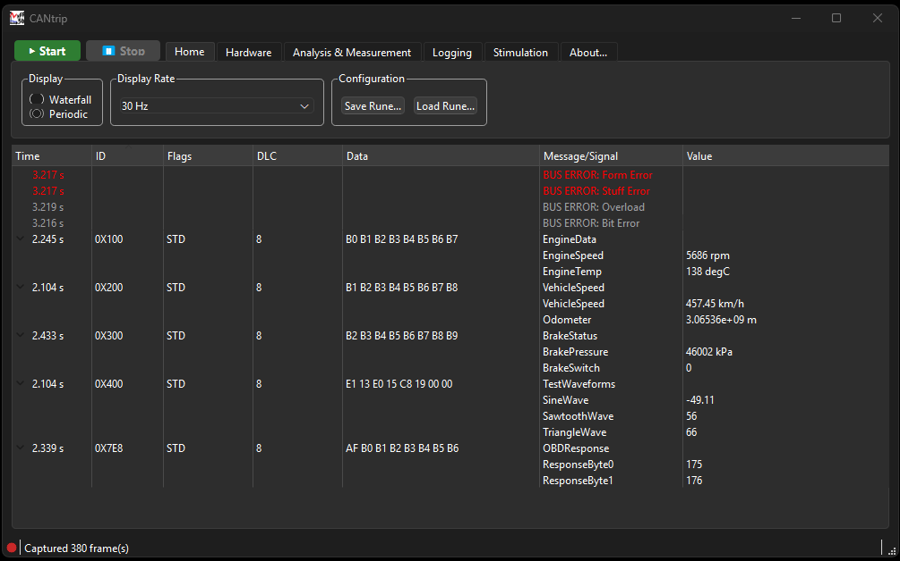
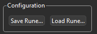

# Home Tab

## Start / Stop

The primary capture control isn't actually on the Home tab's page, it's
pinned into the ribbon's tab bar itself (top-left corner, the green **▶
Start** / red **⏸ Stop** pair), so it stays reachable from every other tab -
you don't need to switch back to Home to stop a capture you started while
looking at, say, the [Stimulation tab](stimulation-tab.md).

Start begins a capture on whichever channel is selected on the
[Hardware tab](hardware-tab.md), using whatever bus timing is currently
configured there. Stop ends it. The status LED at the bottom-left of the
window mirrors capture state: solid red when idle, blinking green/gray
while capturing.

## Display

Two modes, radio-selected:

- **Waterfall** - every frame is its own new row, newest first. This is
  what you want for watching individual events unfold in order.
- **Periodic** - one row per distinct CAN ID, updated in place as new
  frames for that ID arrive. The row shows the measured period (time since
  the previous frame with that ID) instead of a growing list. A row that
  hasn't seen a new frame in 2 seconds grays out, so a message that stopped
  transmitting is visually obvious without disappearing from the table.

Periodic mode is generally more useful for a live, healthy bus (you get one
stable row per signal source instead of an ever-scrolling wall of frames);
Waterfall is more useful when you specifically care about sequence and
timing between individual frames.

The [Stimulation tab](stimulation-tab.md#received-pane) has its own,
independent copy of this same toggle for its received-frames pane.

Waterfall keeps the newest 100,000 rows, about 25 seconds of a full
500 kbit/s bus, so a long capture can't slow the view down or fill up
memory. Older rows only leave the Trace view:
[Logging](logging-tab.md) and the
[Graph view](analysis-and-measurement-tab.md) still get every frame.

## Filtering and sorting the trace

Click a column's name to filter that column. A text box opens over the
header, and rows filter as you type, including during a live capture.

- Matching is "contains" and ignores case. `0x7` in **ID** finds `0x7E8`
  but not `0x170`, while `7` finds both.
- **Message/Signal** matches message names and signal names, and typing a
  signal's name keeps its message on screen. Use it for names, because
  **Data** only holds hex bytes. In **Data**, `A0 A1` and `A0A1` both work.
- Filters on several columns combine, so a row has to match all of them.
- A filtered column shows its text in the header with a colored line under
  it, and the status bar shows how many rows are on screen.
- Press Enter to close the box and keep the filter. Press Esc to clear it.
- Bus error rows have no ID or data, so a filter on those columns hides
  them. Filter **Message/Signal** on `BUS ERROR` to see only those.

Filters only change what's on screen. Logging, the Graph view and bus load
all keep seeing every frame, and filters stay in place when you restart a
capture.

To sort, click the small arrow at the right edge of a column, and click it
again to flip the direction. Waterfall starts newest first, Periodic starts
in ID order. Drag a column's name to reorder columns, or drag the edge
between two columns to resize them.

## Display Rate

A busy real CAN bus can produce far more frames per second than decoding
and repainting a row for every single one can keep up with in real time -
this is a genuine, previously-hit freeze bug (root-caused with ProcDump and
WinDbg against a real busy bus), not a hypothetical concern. This setting
throttles how often the UI actually repaints:

- **Unlimited** - exact frame-by-frame behavior, no buffering. May freeze
  on a genuinely busy bus.
- **30 Hz** (default), **10 Hz**, **5 Hz** - only the latest frame per row
  (Periodic) or a bounded queue of frames (Waterfall) gets displayed at
  this rate, so frames aren't necessarily all individually painted on a
  fast bus.

This only throttles *display*. [Logging](logging-tab.md) and the Graph view
always see every single frame regardless of this setting, and so does a
[Stimulation](stimulation-tab.md) message's own transmit accounting - the
throttle exists purely to keep the UI responsive, never to drop data.

## Configuration (Runes)

**Save Rune...** and **Load Rune...** save/restore your whole environment -
channel selection, bus timing, display mode/rate, DBC path, Graph view
layout, configured Stimulation messages, Trace view column layout, and the
listen-only setting. See [Runes](runes.md) for the full field list and what
happens when you load an older rune missing a newer field.

